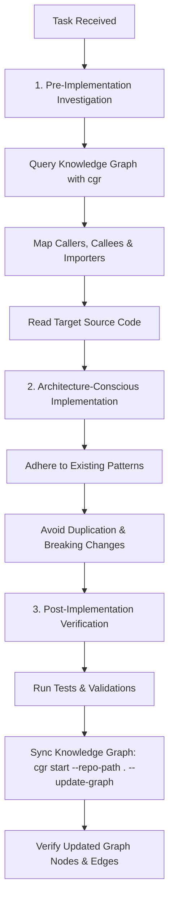

# AI Agent Working Guidelines — Sony Xperia Z Ultra (togari)

This file defines the mandatory working instructions, architectural guidelines, and codebase intelligence standards for all AI agents and developers working in this repository.

---

## Code-Graph-RAG Knowledge Graph Integration

### 1. What Code-Graph-RAG Does in This Project
[Code-Graph-RAG](https://docs.code-graph-rag.com/) (`cgr`) is the persistent codebase knowledge graph and architectural intelligence system for this project.

Instead of treating the codebase as a flat collection of files or unindexed text tokens, Code-Graph-RAG parses the repository using Tree-sitter and AST-Grep across all languages (Python, Bash/Shell, JavaScript, Markdown, HTML, C/C++, etc.). It indexes:
- Modules, packages, and file hierarchies
- Function definitions, spans, line numbers, and parameters
- Call graphs (`CALLS` relationships between callers and callees)
- Module import dependencies (`IMPORTS`)
- Class and interface definitions and overrides
- Documentation links and markdown heading hierarchies

The knowledge graph is persisted in an embedded SQLite backend (`~/.cgr/graph.sqlite`), requiring zero cloud services or external daemons for deterministic local queries.

---

### 2. How to Check Whether Code-Graph-RAG Is Installed
To verify that Code-Graph-RAG is installed and healthy, run:

```powershell
# Check cgr executable and version
cgr --version

# Run diagnostic health check
cgr doctor
```

Expected diagnostic status:
- `PASS Embedded graph (SQLite) connection successful`
- `PASS Graph structural integrity verified`
- `PASS ripgrep is installed`

If `cgr` command is not recognized, check Python 3.12+ scripts directory (`%LOCALAPPDATA%\Programs\Python\Python312\Scripts`).

---

### 3. How to Install It if Missing
Code-Graph-RAG requires Python 3.12+.

Run the automated setup script:
```powershell
powershell -ExecutionPolicy Bypass -File .\scripts\setup_cgr.ps1
```

Or install manually via pip:
```powershell
# Install code-graph-rag with Tree-sitter full grammar and AST-Grep support
pip install "code-graph-rag[treesitter-full,ast-grep]>=0.6.0"

# Verify ripgrep (rg) is in PATH (install via winget if missing)
winget install --id BurntSushi.ripgrep.MSVC --exact --accept-source-agreements --accept-package-agreements
```

---

### 4. How to Initialize and Generate the Project Graph
To index or refresh the project knowledge graph:

```powershell
# Standard incremental sync (updates changed files in under 1 second)
cgr start --repo-path . --update-graph

# Or use the convenience script
powershell -ExecutionPolicy Bypass -File .\scripts\cgr_sync.ps1

# Full clean rebuild (resets hash cache and re-indexes all files)
cgr start --repo-path . --clean --yes --update-graph
```

To view the graph nodes and relationship summary:
```powershell
cgr stats --repo-path .
```

---

### 5. How to Query the Graph

The graph provides deterministic, fast JSON queries without needing an LLM or cloud API keys:

#### A. Resolve Symbols
```powershell
cgr graph resolve "<symbol_or_filename>" --repo-path .
```

#### B. Inspect Definition & Source Span
```powershell
cgr graph definition "<qualified_name>" --repo-path .
# Example:
# cgr graph definition "xperia-z-ultra__e5c9c90b.tools.proxy.handle_client" --repo-path .
```

#### C. Inspect Callers (Who calls this function?)
```powershell
cgr graph callers "<qualified_name>" --repo-path .
# Example:
# cgr graph callers "xperia-z-ultra__e5c9c90b.tools.proxy.forward_stream" --repo-path .
```

#### D. Inspect Callees (What does this function invoke?)
```powershell
cgr graph callees "<qualified_name>" --repo-path .
# Example:
# cgr graph callees "xperia-z-ultra__e5c9c90b.tools.proxy.handle_client" --repo-path .
```

#### E. Graph-Ranked Context Slice (Budgeted Context for AI Tasks)
```powershell
cgr context "<symbol_name>" --repo-path .
# Returns the target source, caller lines, callee signatures, and docstrings within token budget.
```

#### F. Structural Code Health & Dead Code Detection
```powershell
cgr dead-code --repo-path .
cgr check --repo-path .
```

#### G. Natural Language Assistant (Requires configured LLM or local Ollama)
```powershell
cgr start --repo-path . --ask-agent "Explain the proxy forwarding flow in tools/proxy.py"
```

---

### 6. Mandatory AI Agent Workflow

AI agents working in this repository **MUST** adhere to the following 3-phase workflow for all software development tasks:



#### Step 1: Before Implementing Changes (Investigation)
1. Query the Knowledge Graph for the relevant module, function, or file (`cgr graph resolve` / `cgr context`).
2. Identify dependencies: check callers (`cgr graph callers`), callees (`cgr graph callees`), and importers (`cgr graph importers`).
3. Read original source files to confirm exact logic and semantics. Do not rely solely on memory or cached guesses.
4. Formulate an implementation plan respecting existing design patterns and interfaces.

#### Step 2: During Implementation (Execution)
1. Follow existing project conventions (Python socket/threading patterns, shell script safety flags `set -euo pipefail`, web dashboard styling).
2. Avoid unnecessary duplication of existing helper functions.
3. Verify that changes to signatures do not break downstream callers identified during Step 1.

#### Step 3: After Implementation (Verification & Graph Synchronization)
1. Run relevant syntax checks, scripts, or test routines.
2. Synchronize the Knowledge Graph:
   ```powershell
   cgr start --repo-path . --update-graph
   ```
3. Check `cgr stats --repo-path .` to confirm that newly added or modified files/symbols are indexed.
4. Report any graph synchronization warnings or errors immediately.

---

### 7. Handling Installation or Graph-Generation Failures

- **Missing Tree-Sitter Grammars:** If `cgr start` warns that certain file extensions are only indexed as plain files, install the required grammar packages using `pip install "code-graph-rag[treesitter-full,ast-grep]"`.
- **Ripgrep Missing:** Ensure `rg.exe` is located in PATH. If missing, `winget install BurntSushi.ripgrep.MSVC` or place `rg.exe` in the Python `Scripts` folder.
- **Corrupted Sync Cache:** If an interrupted sync causes state mismatches, execute `cgr start --repo-path . --clean --yes --update-graph` to wipe and reconstruct the SQLite index cleanly.
- **Ollama/Model Warning in Doctor:** Note that `cgr doctor` reports model connection failures if a local Ollama daemon is not active. This affects only natural-language `--ask-agent` queries; all core knowledge graph features (`cgr graph`, `cgr context`, `cgr stats`, `cgr dead-code`) use the local SQLite engine and operate deterministically without requiring an LLM daemon.
